## Query Problems
For this assignment you must create and execute queries against the Northwind database to fulfill the requirements listed below.

For each problem where a multi-row answer set is created, as a “hint”, the number of rows to expect in your answer set is listed in parentheses after the problem/question. It may happen that some queries DO NOT produce an answer set.

1. List in alphabetical order without duplicates the Title of Courtesy for employees. (5)
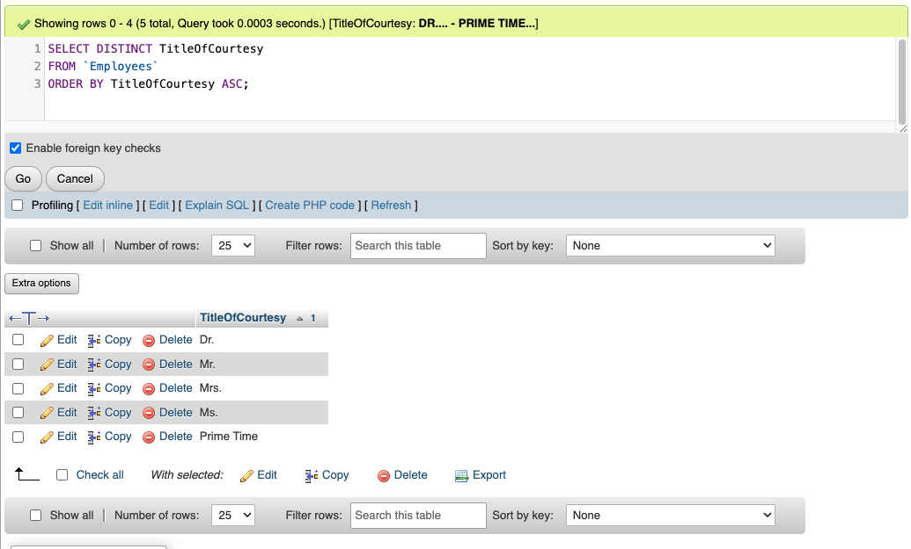
2. List only the name of the company(s) that reside in London and a field called Contact that contains the name and title of the contact person for that company. (6)
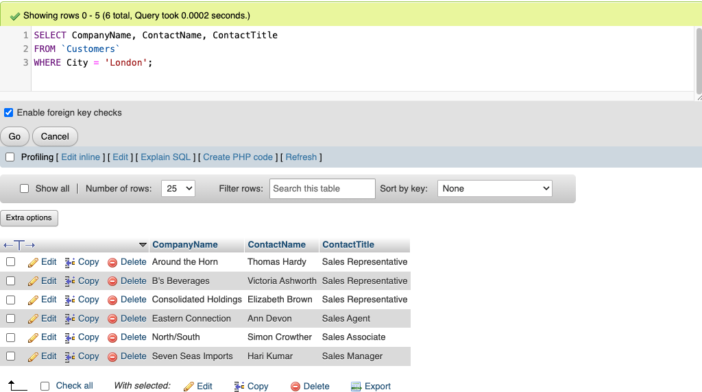
3. List the ProductID, ProductName, UnitPrice, and UnitsInStock for all products that have a value between 19 and 19.5 for the price. Make sure results are sorted by the price. (4)
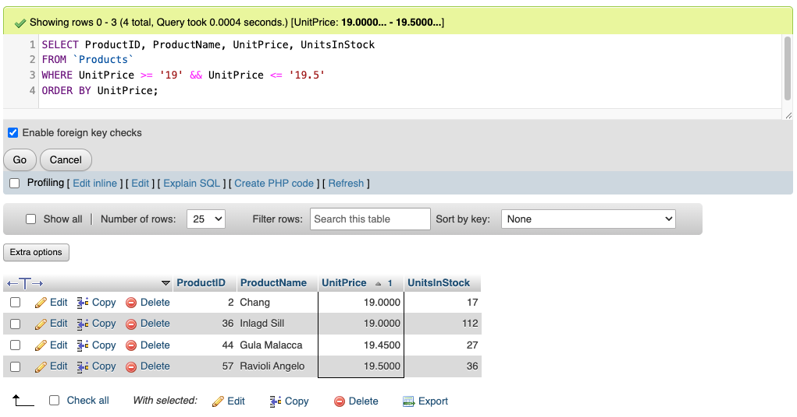
4. List the ProductID, ProductName, UnitPrice, and UnitsInStock by the number of units in stock.
Only show products that have a value less than 14.0 for the price and have at least 100 units available. (2)
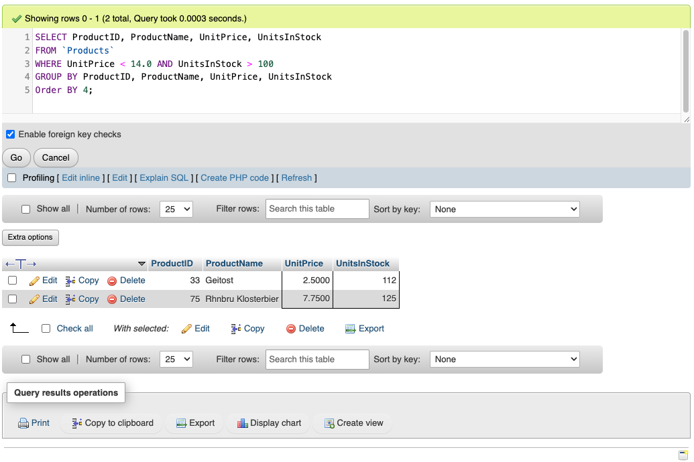
5. List the product ID, name, and price for all products that are in the "Seafood" category (Use a subquery matching the category name). Show the most expensive items first. (12)
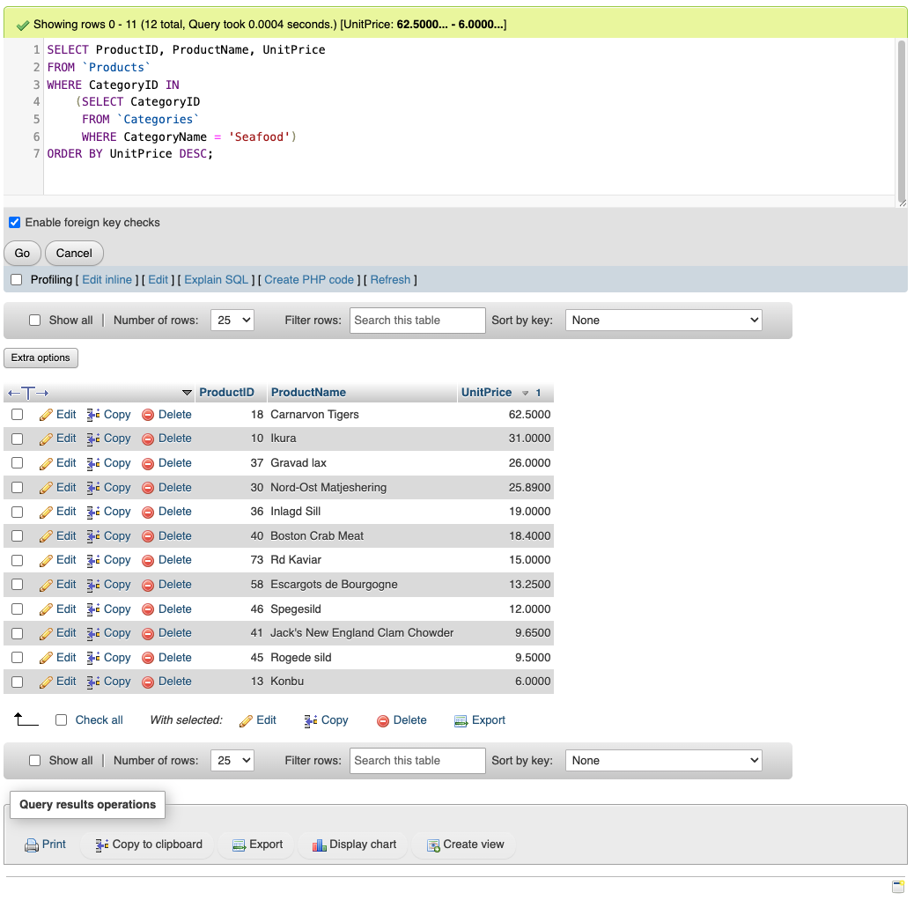
6. List the top 5 products in the company's inventory where the product is discontinued and they still have inventory. Display the product's name, unit price and total inventory value from most to least. Make the column headers "Name, Price, and Inventory Value". (4)
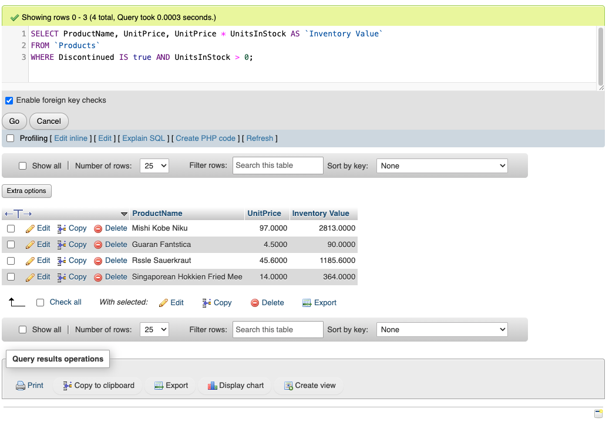
7. List each of the Sales employees' total number of orders (# Orders) and First and Last name together (Name). List the highest counts first. (7)
Hint: Employees holding managerial roles are not being considered.
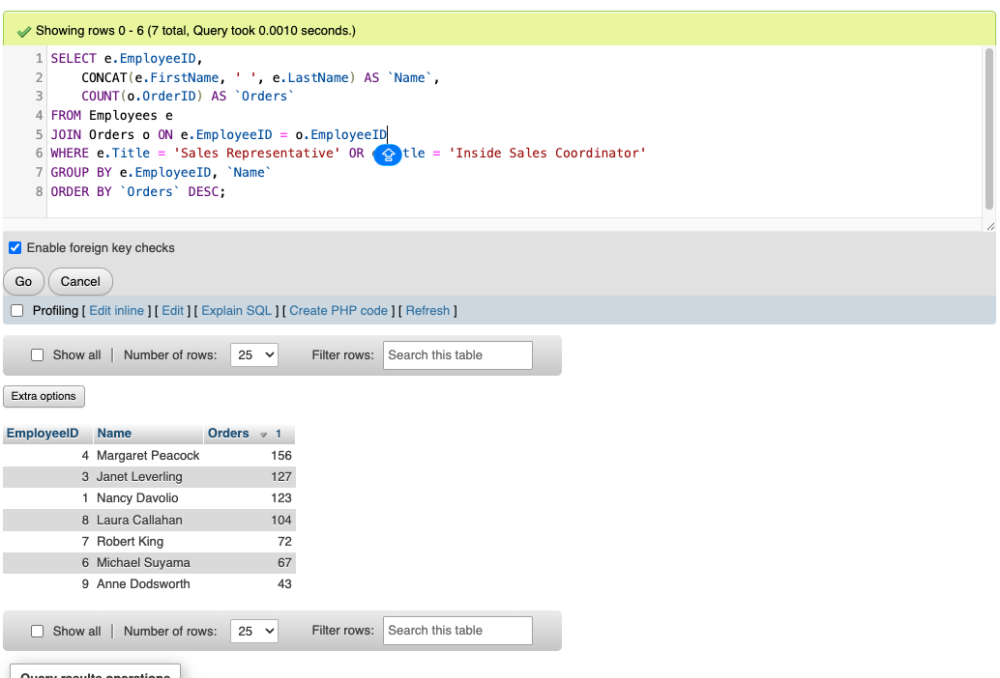
8. List each of the Sales Representatives' total number of orders (# Orders) and First and Last name together (Name). List the highest counts first and only if the count is at least 100. (3)
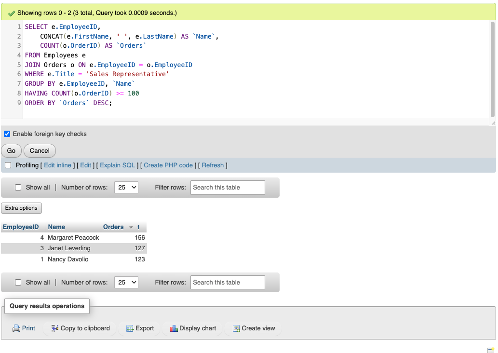
9. List all Suppliers by country ascending if the supplier’s region is not indicated. (20)
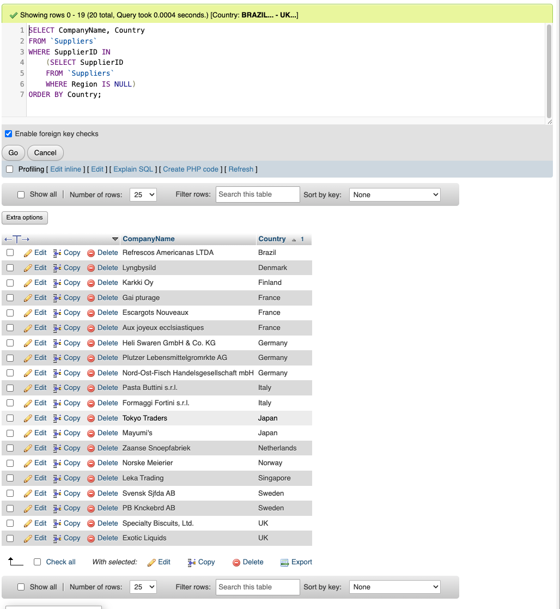
10. Using a RIGHT JOIN of Orders to Employees, find all employees that do not have any orders (without grouping the data). Print the Full Name (First, space, Last) and the salary of the employee. (1)
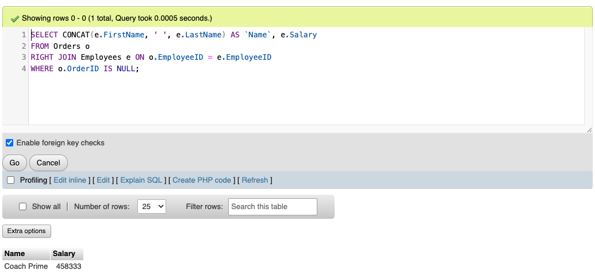
11. Find all orders that were shipped over a week (7 days) later than required date. (9)
Also answer the following questions in your submission for this problem:
    1. **Which fields should be displayed and why?**
       The columns that should be displayed are `CustomerName` `OrderID`, `Employee`, `RequiredDate`, `ShippedDate`, `DaysDifference` (created in SELECT query). These columns provide sufficient information to know basic information about the order. Including the Employee also helps to speed up any customer service issues that may arise from a delayed shipment. 
    2. **How should the results be ordered?**
       I think that the order is closely tied to the business case. Since we don't have that, I chose to arrange them in descending order based on the biggest difference in days. If Customer tiers were part of the database, this could be an alternate sorting to bring top clients the best and fastest service. 
       
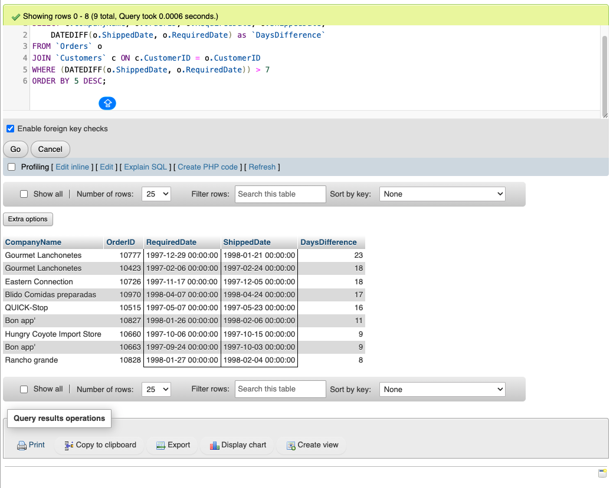